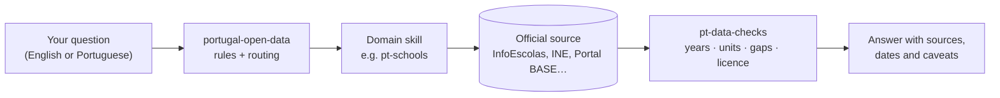

<div align="center">


# Portugal Open Data

**Portugal publishes 20,983 open datasets.<br>These skills teach your AI agent where the right one is — and how not to misread it.**

[](LICENSE)
[](#the-skills)
[](skills/portugal-open-data/SKILL.md)
[](https://github.com/jorgesousa/portugal-open-data/actions/workflows/check-endpoints.yml)
[](CONTRIBUTING.md)


[Install](#install) · [The skills](#the-skills) · [How it works](#how-it-works) · [**Help wanted**](#help-wanted) · [Roadmap](#roadmap) · [Leia em português](README.pt.md)

</div>

---

## Why this exists

Public data is easy to fetch and easy to get wrong. Most mistakes are not in the API call but in what the number means. An agent left alone will happily:

| You ask | A plain agent | An agent with these skills |
|---|---|---|
| "How much did Arouca council spend in 2025?" | Adds up contract values and calls it spending. | 163 contracts, €18.05 M signed in 2025 (Portal BASE). Says contracts are not total spending and shows the council's expenditure from INE/DGAL next to it, with both years. |
| "Which is the best secondary school in Coimbra?" | Ranks raw averages, which mostly rank family income. | Compares each school with pupils of a **similar profile** ("observed vs expected"), shows sample sizes and says the data is from the February 2025 edition. |
| "Is there a bus at 8:00 on Saturday?" | Reads the timetable file and answers. | Checks first that the feed has not expired — the Coimbra one ends on 12 November. |
| "Can I use this list of psychologists for my business?" | "It's public domain, go ahead." | The licence is open, but it is a list of named people with phones and e-mails: use counts, not contacts. |

Every trap in these skills was hit in real work and is written down with the date it was checked.

## The skills

| | Skill | What your agent learns |
|---|---|---|
| 🧭 | [`portugal-open-data`](skills/portugal-open-data/SKILL.md) | **Start here.** Rules for calling public sources, the general ones (dados.gov.pt, INE, IPMA, Banco de Portugal, Parliament, Eurostat, ECB) and which skill to use next. |
| ✅ | [`pt-data-checks`](skills/pt-data-checks/SKILL.md) | Eight checks before publishing any number: years, units, what it measures, gaps, outliers, duplicates, fair comparison, licence. |
| 🧾 | [`pt-public-procurement`](skills/pt-public-procurement/SKILL.md) | Portal BASE and TED. Every field and how often it is filled in; signing year vs publication; suppliers by tax number. |
| 🗺️ | [`pt-territory`](skills/pt-territory/SKILL.md) | Official boundaries (CAOP), municipality and parish codes, NUTS, the 2025 parish restoration, projections. |
| 🏫 | [`pt-schools`](skills/pt-schools/SKILL.md) | InfoEscolas for every school: results against pupils of a similar profile, retention, internal grades, equity. |
| 💶 | [`pt-local-finance`](skills/pt-local-finance/SKILL.md) | Council revenue, expenditure and debt (INE/DGAL), budgets, transfers, IMI. |
| 🏛️ | [`pt-council-meetings`](skills/pt-council-meetings/SKILL.md) | Minutes, agendas and videos; OpenCouncil's public MCP; privacy rules for members of the public. |
| 🗄️ | [`pt-web-archive`](skills/pt-web-archive/SKILL.md) | Arquivo.pt: what a Portuguese website said in 2009, found by text or URL. |
| 🚌 | [`pt-mobility`](skills/pt-mobility/SKILL.md) | GTFS and NeTEx timetables by operator, bike sharing, EV charging, road and rail networks. |
| 🏥 | [`pt-health`](skills/pt-health/SKILL.md) | Transparência SNS, ACSS, INFARMED, INEM — and why the same dataset appears twice with two licences. |
| 🌊 | [`pt-environment`](skills/pt-environment/SKILL.md) | APA water and air data, emissions, flood risk, rural fires, civil protection. |

Each skill loads only when a request needs it, so installing all eleven costs nothing until they are used.

## How it works



The skills are text. They make no requests and need no keys: they tell your agent where to ask, what the answer means and where it lies. If your environment blocks a domain, the agent is told to stop and name it, never to get around the block.

## Install

**Claude Code** — as a plugin:
```
/plugin marketplace add jorgesousa/portugal-open-data
/plugin install portugal-open-data@portugal-open-data
```

**claude.ai** (web, desktop, mobile) — download the zips from [`dist/`](dist/) (one per skill; start with `portugal-open-data.zip` and `pt-data-checks.zip`) and upload them in your settings, under skills.

**Cursor, Codex and other agents:**
```bash
npx skills add jorgesousa/portugal-open-data
```

**By hand:** copy the folders in `skills/` to `~/.claude/skills/`.

## Try it

- "Which suppliers got the most from Arouca council in 2025? Join them by tax number."
- "Compare the secondary schools in Coimbra fairly."
- "How much does Braga council owe per resident, compared with similar municipalities?"
- "What did the Coimbra council website say about the Metro Mondego in 2015?"
- "How many bus departures does this parish get on a weekday?"
- "Can I use IPMA weather data in a paid app?"

## Help wanted

**This is an open project, and Portugal's public data is bigger than one person.** If you work with Portuguese data — as a developer, journalist, researcher, civil servant or curious citizen — you already know a trap that is not written down here. That is the most useful contribution there is.

### 15 minutes: verify one source
These entries are marked "to verify" in the skills. Test one, write down what you found, open a pull request.

- [ ] Transparência SNS: record queries (`/records?where=…`) on a real dataset — `pt-health`
- [ ] Arquivo.pt: the CDX server and the image search API — `pt-web-archive`
- [ ] SNIRH and QualAr: is there a stable way to download readings? — `pt-environment`
- [ ] ProCiv occurrences: the endpoint listed on dados.gov.pt dates from 2021 — `pt-environment`
- [ ] AGIT planner API (Região de Coimbra) — `pt-mobility`
- [ ] CP, Metro do Porto, STCP: where are their GTFS feeds? — `pt-mobility`
- [ ] State transfers to each municipality (FEF, FSM) as data, not PDF — `pt-local-finance`
- [ ] GeoAPI.pt: confirm the paths and the licence — `pt-territory`
- [ ] TED: confirm the query syntax and the licence — `pt-public-procurement`

### An afternoon: tell us what lies
Found a number that means something other than what it seems? A field that is always empty, a unit that changed, a file that moved? [Open an issue](../../issues/new/choose) with the dataset and what you saw. We turn it into a rule.

### A weekend: write a domain skill
See [Roadmap](#roadmap) and the [skill template](docs/skill-template.md). One domain, one folder, one `SKILL.md` under 500 lines.

Read [CONTRIBUTING.md](CONTRIBUTING.md) before your first pull request. Contributions in English or Portuguese are welcome.

## Roadmap

| Next skill | Where the data is | Why |
|---|---|---|
| `pt-elections` | Comissão Nacional de Eleições (33 datasets on dados.gov.pt), Ministry results | Results by parish need the territory rules and fair comparisons |
| `pt-housing` | INE median rents and sales by municipality (among the most reused data on the portal), IMI rates | High demand, many per-m² and per-quarter traps |
| `pt-tourism` | Turismo de Portugal (314 datasets), local accommodation registers | Big, scattered, mostly per municipality |
| `pt-energy` | DGEG, LNEG (OGC API), INE energy indicators | Renewable shares, maps of resources |
| `pt-companies` | IRN, startup status list, Portal BASE suppliers | Who the companies are behind the tax numbers |
| `pt-parliament` | Assembleia da República open data (now in the entry skill) | Deserves its own method: votes, initiatives, MPs |

Have another idea? Open an issue with the "new skill" template.

## Keeping it honest

- **Weekly check.** A [GitHub Actions workflow](.github/workflows/check-endpoints.yml) calls every source on Mondays. Sources that are known to be unstable give a warning instead of failing.
- **Validation on every pull request.** [`scripts/validate-skills.py`](scripts/validate-skills.py) checks names, descriptions, length, links and references between skills.
- **Dates everywhere.** Each skill has `metadata.verified`; anything older than six months gets re-checked before anyone relies on it.
- **No personal data.** Lists of named people are aggregated, never republished for a new purpose.

## Layout

```
.claude-plugin/          plugin and marketplace manifests, icon
skills/<name>/SKILL.md   one folder per skill (some with references/)
dist/*.zip               one zip per skill, for claude.ai
scripts/                 endpoint check, skill validator, zip builder
docs/                    skill template, README images
.github/                 workflows, issue and pull-request templates
```

## Coming from `apis-publicas-pt`?

Version 2.0.0 renamed the project and split the old catalog into an entry point and domain skills: `apis-publicas-pt` → `portugal-open-data`, `verificar-dados-publicos` → `pt-data-checks`, `reunioes-municipais-pt` → `pt-council-meetings`. Remove the old zips and install the new ones.

## License

[MIT](LICENSE) © 2026 [Jorge Sousa](https://github.com/jorgesousa) and contributors.

Not affiliated with any of the sources listed. The data belongs to each source and follows its own terms.
