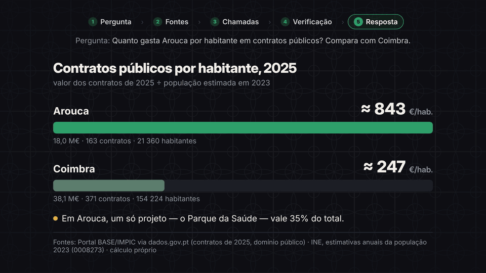

<div align="center">

# apis-publicas-pt

**Portugal's and the EU's public data, ready for your AI agent.**

Three skills for Claude, Claude Code and other agents that read `SKILL.md`: a curated catalog of Portuguese and EU open-data APIs, a checklist that stops the agent from publishing a misleading number, and a guide to Portuguese municipal council meetings.

[](LICENSE)
[](skills/apis-publicas-pt/SKILL.md)
[](https://github.com/jorgesousa/apis-publicas-pt/actions/workflows/check-endpoints.yml)



**[Leia em português](README.pt.md)**

</div>

---

## The three skills

| Skill | What it does |
|---|---|
| [`apis-publicas-pt`](skills/apis-publicas-pt/SKILL.md) | Catalog of 13 sources (plus the OParl data standard) — national statistics, weather, central banks, public procurement, parliament and local councils — each with endpoint, auth, licence, limits, pitfalls and a working example. |
| [`verificar-dados-publicos`](skills/verificar-dados-publicos/SKILL.md) | Eight checks to run before publishing a number from public data: reference years, units, what it really measures, gaps, outliers, duplicated entities, fair comparison and licence. |
| [`reunioes-municipais-pt`](skills/reunioes-municipais-pt/SKILL.md) | Council meetings (Câmara and Assembleia Municipal): OpenCouncil's public MCP where it exists, official minutes and videos elsewhere, a transcription pipeline, Portuguese privacy rules (CNPD) and the OParl data model. |

They work alone, but are made to be used together: the catalog finds and calls the data, the checklist makes sure the answer is honest about it, and the meetings guide covers what councils discuss and decide.

## Why

The best-known API list on GitHub, [public-apis](https://github.com/public-apis/public-apis), has 2,000+ entries. For Portugal it has almost nothing:

| Source | public-apis | apis-publicas-pt |
|---|:---:|:---:|
| dados.gov.pt | ✅ | ✅ |
| IPMA (weather) | ✅ | ✅ |
| INE (Statistics Portugal), incl. municipal budgets | ❌ | ✅ |
| Banco de Portugal (BPstat) | ❌ | ✅ |
| Assembleia da República (parliament) | ❌ | ✅ |
| OpenCouncil Portugal (council meetings) | ❌ | ✅ |
| Eurostat | ❌ | ✅ |
| European Central Bank | ❌ | ✅ |
| TED (EU public procurement) | ❌ | ✅ |

And a link is not enough. Before building anything you need to know whether the API needs a key, whether you can use the data in a commercial product, and where the traps are — like INE's municipal finance figures being in **thousands** of euros, or Eurostat returning an empty "latest" year. That is what these skills give your agent.

## What's in the catalog

| Source | What you get | Key | Licence | Status |
|---|---|:---:|---|---|
| [dados.gov.pt](https://dados.gov.pt) | National open-data portal (Portal BASE contracts, councils, agencies) | no | per dataset | ✅ |
| [INE](https://www.ine.pt) | Official statistics: population, municipal revenue and expenditure | no | CC BY | ✅ |
| [IPMA](https://api.ipma.pt) | Forecasts, warnings, earthquakes, fire risk | no | ⚠ non-profit only | ✅ |
| [Banco de Portugal](https://bpstat.bportugal.pt) | BPstat economic and financial series | no | free reuse (ESCB) | ✅ |
| [GeoAPI.pt](https://geoapi.pt) | Municipalities, parishes, postcodes (unofficial) | no | not stated | ✅ |
| [Assembleia da República](https://www.parlamento.pt/Cidadania/Paginas/DadosAbertos.aspx) | Initiatives, votes, debates, MPs (XML/JSON files) | no | attribution required | ✅ |
| [OpenCouncil Portugal](https://pt.opencouncil.eu) | Transcribed council meetings, with a public MCP server (Cascais so far) | no | free reuse | ✅ |
| [Eurostat](https://ec.europa.eu/eurostat) | EU statistics (JSON-stat, SDMX) | no | free, incl. commercial | ✅ |
| [ECB](https://data.ecb.europa.eu) | Exchange rates, interest rates, monetary data | no | free, incl. commercial | ✅ |
| [TED](https://ted.europa.eu) | EU public procurement above thresholds | no | to confirm | ✅ |
| [data.europa.eu](https://data.europa.eu) | European data portal | no | per dataset | 🔍 |
| [Open-Meteo](https://open-meteo.com) | Global weather | no | ⚠ non-commercial | ✅ |
| OParl | Data model for council information (reference standard) | — | — | 📐 |
| Transparência SNS | Health service data | — | — | 🔍 |

✅ endpoint answered in the [weekly check](.github/workflows/check-endpoints.yml) · 🔍 responds, but query details still to verify · 📐 a standard, not a data source.

## Install

### claude.ai (web, desktop, mobile)
1. Download the zips from [`dist/`](dist/): [`apis-publicas-pt.zip`](dist/apis-publicas-pt.zip), [`verificar-dados-publicos.zip`](dist/verificar-dados-publicos.zip) and [`reunioes-municipais-pt.zip`](dist/reunioes-municipais-pt.zip).
2. Upload them in the skills section of your claude.ai settings.
3. If your plan restricts network access, allow the domains you need (see [Network](#network)).

### Claude Code
```bash
git clone https://github.com/jorgesousa/apis-publicas-pt.git
mkdir -p ~/.claude/skills
cp -r apis-publicas-pt/skills/* ~/.claude/skills/
```
For a single project, copy the folders into that project's `.claude/skills/` instead.

### With the `skills` CLI (Claude Code, Cursor, Codex and other agents)
```bash
npx skills add jorgesousa/apis-publicas-pt
```

## Try it

Once installed, the skills kick in on their own when a request involves Portuguese or EU public data. Ask in English or Portuguese:

- "What was Coimbra's resident population in 2023? Cite the source."
- "How much did Arouca's council spend in 2023, and how much of it came from its own revenue?"
- "Compare public contracts per resident in Arouca and Coimbra in 2025."
- "What did Cascais council discuss about housing this year? Quote the councillors."
- "Where can I find the minutes and videos of Matosinhos municipal assembly?"
- "Can I use IPMA weather data in a paid app?"

## Network

The skills make no requests themselves: they tell the agent where and how to ask. If your environment only allows approved domains, the catalog uses:

`dados.gov.pt` · `www.ine.pt` · `api.ipma.pt` · `bpstat.bportugal.pt` · `json.geoapi.pt` · `www.parlamento.pt` · `app.parlamento.pt` · `pt.opencouncil.eu` · `ec.europa.eu` · `data-api.ecb.europa.eu` · `api.ted.europa.eu` · `data.europa.eu` · `api.open-meteo.com`

If a domain is blocked, the skill tells the agent to stop and name it, instead of trying to get around the block.

## Safety and principles

- **Text only.** Each skill is a single `SKILL.md`. Nothing to install, no scripts, no dependencies.
- **No keys.** Every source is readable without registering. The agent is told never to put credentials in URLs or files.
- **Licences up front.** The agent cites source and date, and warns when a licence forbids commercial use.
- **Honest about gaps.** Anything untested is marked "to verify" and should not reach production.

## Keeping it current

Public APIs change, so:

- **Weekly check:** a [GitHub Actions workflow](.github/workflows/check-endpoints.yml) calls every endpoint on Mondays and publishes the result. Run `./scripts/check-endpoints.sh` to check locally.
- **Verification date:** each version says when it was verified. Entries older than six months get re-checked before anyone relies on them.

## Contributing

Missing a source? Open an issue or a pull request. A source joins the catalog only with:

1. a tested endpoint (or marked "to verify");
2. auth;
3. licence, with a link to the terms;
4. limits (or "not published");
5. an example call;
6. the verification date.

After editing a `SKILL.md`, rebuild the claude.ai zips with `./scripts/build-zip.sh`.

## Layout

```
skills/apis-publicas-pt/SKILL.md          the catalog
skills/verificar-dados-publicos/SKILL.md  the checklist
skills/reunioes-municipais-pt/SKILL.md    the council meetings guide
dist/*.zip                                the same skills, ready to upload to claude.ai
scripts/check-endpoints.sh                checks every source still answers
scripts/build-zip.sh                      builds the zips
.github/workflows/                        weekly check
docs/                                     README images
README.pt.md                              Portuguese README
```

## License

[MIT](LICENSE) © 2026 [Jorge Sousa](https://github.com/jorgesousa)

Not affiliated with any of the sources listed. The data belongs to each source and follows its own terms.
