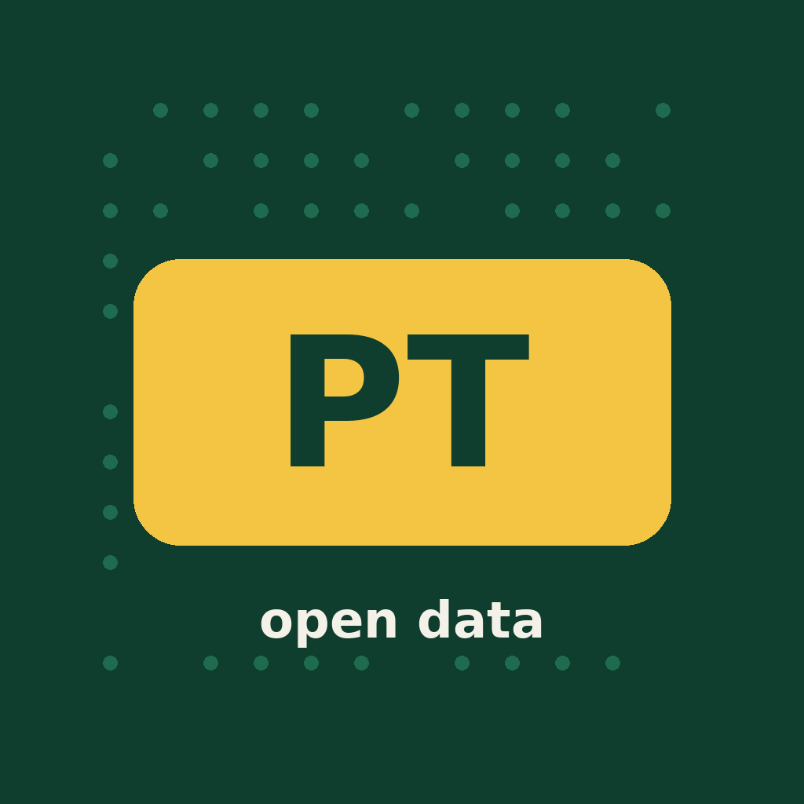
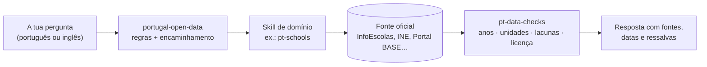

<div align="center">



# Portugal Open Data

**Portugal publica 20 983 conjuntos de dados abertos.<br>Estas skills ensinam o teu agente de IA onde está o certo — e a não o ler mal.**

[](LICENSE)
[](#as-skills)
[](skills/portugal-open-data/SKILL.md)
[](https://github.com/jorgesousa/portugal-open-data/actions/workflows/check-endpoints.yml)
[](CONTRIBUTING.md)


[Instalar](#instalar) · [As skills](#as-skills) · [Como funciona](#como-funciona) · [**Precisamos de ajuda**](#precisamos-de-ajuda) · [Próximas skills](#próximas-skills) · [Read in English](README.md)

</div>

---

## Porquê

Os dados públicos são fáceis de obter e fáceis de interpretar mal. Quase nunca o erro está na chamada à API: está no que o número quer dizer. Um agente sozinho faz isto sem hesitar:

| Perguntas | Um agente sem skills | Um agente com estas skills |
|---|---|---|
| "Quanto gastou a Câmara de Arouca em 2025?" | Soma os valores dos contratos e chama-lhe despesa. | 163 contratos, 18,05 M€ celebrados em 2025 (Portal BASE). Diz que contratos não são a despesa total e mostra ao lado a despesa da câmara do INE/DGAL, com os dois anos. |
| "Qual é a melhor escola secundária de Coimbra?" | Ordena médias brutas, que sobretudo ordenam o rendimento das famílias. | Compara cada escola com alunos de **perfil semelhante** ("observado vs esperado"), mostra o tamanho das amostras e diz que os dados são da edição de fevereiro de 2025. |
| "Há autocarro às 8h no sábado?" | Lê o ficheiro de horários e responde. | Verifica primeiro se o feed não expirou — o de Coimbra acaba a 12 de novembro. |
| "Posso usar esta lista de psicólogos no meu negócio?" | "É domínio público, força." | A licença é aberta, mas é uma lista de pessoas com telefone e email: usa contagens, não contactos. |

Cada armadilha destas skills apareceu em trabalho real e está escrita com a data em que foi verificada.

## As skills

| | Skill | O que o teu agente aprende |
|---|---|---|
| 🧭 | [`portugal-open-data`](skills/portugal-open-data/SKILL.md) | **Começa aqui.** Regras para chamar fontes públicas, as fontes gerais (dados.gov.pt, INE, IPMA, Banco de Portugal, Parlamento, Eurostat, BCE) e qual a skill a usar a seguir. |
| ✅ | [`pt-data-checks`](skills/pt-data-checks/SKILL.md) | Oito verificações antes de publicar um número: anos, unidades, o que mede, lacunas, extremos, duplicados, comparação justa, licença. |
| 🧾 | [`pt-public-procurement`](skills/pt-public-procurement/SKILL.md) | Portal BASE e TED. Cada campo e quantas vezes vem preenchido; ano de celebração vs publicação; fornecedores por NIF. |
| 🗺️ | [`pt-territory`](skills/pt-territory/SKILL.md) | Limites oficiais (CAOP), códigos de concelhos e freguesias, NUTS, a reposição de freguesias de 2025, projeções. |
| 🏫 | [`pt-schools`](skills/pt-schools/SKILL.md) | InfoEscolas para todas as escolas: resultados face a alunos de perfil semelhante, retenção, classificações internas, equidade. |
| 💶 | [`pt-local-finance`](skills/pt-local-finance/SKILL.md) | Receitas, despesas e dívida das câmaras (INE/DGAL), orçamentos, transferências, IMI. |
| 🏛️ | [`pt-council-meetings`](skills/pt-council-meetings/SKILL.md) | Atas, ordens do dia e vídeos; o MCP público do OpenCouncil; regras de privacidade para os munícipes. |
| 🗄️ | [`pt-web-archive`](skills/pt-web-archive/SKILL.md) | Arquivo.pt: o que dizia um site português em 2009, por texto ou por URL. |
| 🚌 | [`pt-mobility`](skills/pt-mobility/SKILL.md) | Horários GTFS e NeTEx por operador, bicicletas partilhadas, carregamento elétrico, redes rodoviária e ferroviária. |
| 🏥 | [`pt-health`](skills/pt-health/SKILL.md) | Transparência SNS, ACSS, INFARMED, INEM — e porque o mesmo dataset aparece duas vezes com duas licenças. |
| 🌊 | [`pt-environment`](skills/pt-environment/SKILL.md) | Água e ar da APA, emissões, risco de inundação, incêndios rurais, proteção civil. |

Cada skill só é carregada quando um pedido precisa dela, por isso instalar as onze não custa nada até serem usadas. Estão escritas em inglês para chegarem a mais gente, mas mantêm os nomes oficiais portugueses e reagem a pedidos em português.

## Como funciona



As skills são texto. Não fazem pedidos e não precisam de chaves: dizem ao agente onde perguntar, o que a resposta quer dizer e onde engana. Se o teu ambiente bloquear um domínio, o agente tem instruções para parar e dizer qual é, nunca para contornar o bloqueio.

## Instalar

**Claude Code** — como plugin:
```
/plugin marketplace add jorgesousa/portugal-open-data
/plugin install portugal-open-data@portugal-open-data
```

**claude.ai** (web, desktop, telemóvel) — descarrega os zips em [`dist/`](dist/) (um por skill; começa por `portugal-open-data.zip` e `pt-data-checks.zip`) e carrega-os nas definições, em skills.

**Cursor, Codex e outros agentes:**
```bash
npx skills add jorgesousa/portugal-open-data
```

**À mão:** copia as pastas de `skills/` para `~/.claude/skills/`.

## Experimenta

- "Que fornecedores receberam mais da Câmara de Arouca em 2025? Junta-os por NIF."
- "Compara de forma justa as escolas secundárias de Coimbra."
- "Quanto deve a Câmara de Braga por habitante, comparada com municípios parecidos?"
- "O que dizia o site da Câmara de Coimbra sobre o Metro Mondego em 2015?"
- "Quantas partidas de autocarro tem esta freguesia num dia útil?"
- "Posso usar dados do IPMA numa app paga?"

## Precisamos de ajuda

**Este é um projeto aberto, e os dados públicos de Portugal são grandes demais para uma pessoa.** Se trabalhas com dados portugueses — a programar, no jornalismo, na investigação, na administração pública ou só por curiosidade — já conheces uma armadilha que não está aqui escrita. É a contribuição mais útil que há.

### 15 minutos: verifica uma fonte
Estas entradas estão marcadas "to verify" nas skills. Testa uma, escreve o que encontraste e abre um pull request.

- [ ] Transparência SNS: consultas de registos (`/records?where=…`) num dataset real — `pt-health`
- [ ] Arquivo.pt: o servidor CDX e a API de pesquisa de imagens — `pt-web-archive`
- [ ] SNIRH e QualAr: há forma estável de descarregar medições? — `pt-environment`
- [ ] Ocorrências da ProCiv: o endpoint listado no dados.gov.pt é de 2021 — `pt-environment`
- [ ] API do planeador da AGIT (Região de Coimbra) — `pt-mobility`
- [ ] CP, Metro do Porto, STCP: onde estão os feeds GTFS? — `pt-mobility`
- [ ] Transferências do Estado para cada município (FEF, FSM) como dados, não PDF — `pt-local-finance`
- [ ] GeoAPI.pt: confirmar caminhos e licença — `pt-territory`
- [ ] TED: confirmar a sintaxe das consultas e a licença — `pt-public-procurement`

### Uma tarde: diz-nos o que engana
Encontraste um número que quer dizer outra coisa? Um campo sempre vazio, uma unidade que mudou, um ficheiro que mudou de sítio? [Abre uma issue](../../issues/new/choose) com o dataset e o que viste. Nós transformamos isso numa regra.

### Um fim de semana: escreve uma skill de domínio
Vê as [próximas skills](#próximas-skills) e o [modelo de skill](docs/skill-template.md). Um domínio, uma pasta, um `SKILL.md` com menos de 500 linhas.

Lê o [CONTRIBUTING.md](CONTRIBUTING.md) antes do primeiro pull request. Contribuições em português ou em inglês, como preferires.

## Próximas skills

| Skill | Onde estão os dados | Porquê |
|---|---|---|
| `pt-elections` | Comissão Nacional de Eleições (33 datasets no dados.gov.pt), resultados oficiais | Resultados por freguesia precisam das regras de território e de comparações justas |
| `pt-housing` | Rendas e vendas medianas do INE por concelho (dos dados mais reutilizados do portal), taxas de IMI | Muita procura, muitas armadilhas de €/m² e de trimestre |
| `pt-tourism` | Turismo de Portugal (314 datasets), registos de alojamento local | Grande, disperso, quase sempre por concelho |
| `pt-energy` | DGEG, LNEG (OGC API), indicadores de energia do INE | Quotas de renováveis, mapas de recursos |
| `pt-companies` | IRN, lista de empresas com estatuto de startup, fornecedores do Portal BASE | Quem são as empresas por trás dos NIF |
| `pt-parliament` | Dados abertos da Assembleia da República (hoje na skill de entrada) | Merece método próprio: votações, iniciativas, deputados |

Tens outra ideia? Abre uma issue com o modelo "new skill".

## Como se mantém honesto

- **Verificação semanal.** Um [workflow do GitHub Actions](.github/workflows/check-endpoints.yml) chama todas as fontes às segundas. As fontes que se sabe serem instáveis dão aviso em vez de falhar.
- **Validação em cada pull request.** O [`scripts/validate-skills.py`](scripts/validate-skills.py) verifica nomes, descrições, tamanho, links e referências entre skills.
- **Datas em todo o lado.** Cada skill tem `metadata.verified`; o que tiver mais de seis meses é verificado de novo antes de alguém confiar nele.
- **Sem dados pessoais.** Listas de pessoas identificadas são agregadas, nunca republicadas para outro fim.

## Estrutura

```
.claude-plugin/          manifestos do plugin e do marketplace, ícone
skills/<nome>/SKILL.md   uma pasta por skill (algumas com references/)
dist/*.zip               um zip por skill, para o claude.ai
scripts/                 verificação de endpoints, validador, criação dos zips
docs/                    modelo de skill, imagens do README
.github/                 workflows, modelos de issue e de pull request
```

## Vens do `apis-publicas-pt`?

A versão 2.0.0 mudou o nome do projeto e dividiu o antigo catálogo numa porta de entrada e em skills de domínio: `apis-publicas-pt` → `portugal-open-data`, `verificar-dados-publicos` → `pt-data-checks`, `reunioes-municipais-pt` → `pt-council-meetings`. Remove os zips antigos e instala os novos.

## Licença

[MIT](LICENSE) © 2026 [Jorge Sousa](https://github.com/jorgesousa) e contribuidores.

Sem ligação a nenhuma das fontes. Os dados pertencem a cada fonte e seguem os seus próprios termos.
